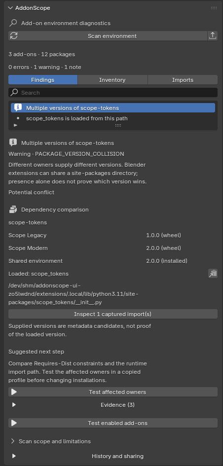
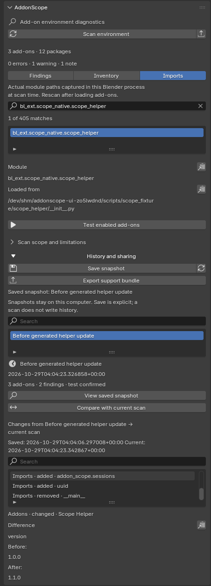

# AddonScope

定位 Blender 插件冲突的依赖来源，再用独立进程复现和缩减失败组合。

[English](README.md) · [机制与来源](docs/RESEARCH.md) · [验证记录](docs/VERIFICATION.md) · [完整路线](docs/ROADMAP.zh-CN.md)

两个插件单独能用，一起启用就报错。AddonScope 把“插件携带的包版本”和“Python 实际加载的路径”放在一起看，再在文件副本中测试注册。全部诊断信息都能在 Blender 内查看，导出只用于分享和留档。

**当前版本为 0.3.0 Alpha。** 已在 Linux + Blender 4.5.15 LTS 验证；Windows、macOS、Blender 5.x 仍需各自的实机证据。最终验证范围见 [VERIFICATION](docs/VERIFICATION.md) 和 [发布清单](docs/RELEASE_CHECKLIST.md)。

## 30 秒上手

1. 下载 `addon-scope-0.3.0.zip`，或运行下方构建命令。
2. Blender「编辑 → 偏好设置 → 获取扩展」菜单选择「从磁盘安装」，选 ZIP 并启用。安装插件 ZIP，不要安装源码包。
3. 3D 视图按 **N**，打开 **AddonScope → Scan environment**。
4. 选择问题，对照插件归属、携带版本、实际导入路径。**Inventory / Imports** 可搜索完整元数据和模块来源，选中后可复制全文。

扫描只读元数据和当前导入快照，不导入、启用、移除或修改被检查插件。静态提示只是排查线索，不代表已经证实插件冲突。

## 原生界面

| 依赖版本与实际来源 | 历史与当前环境对比 |
| --- | --- |
|  |  |

图片来自实际 Blender 4.5.15，内容为生成的测试插件。历史示例将生成插件的 manifest 从 1.0.0 改为 1.1.0 后重新扫描，不是真实第三方插件的成功案例。

## 复现和缩减

- **Test affected owners**：测试当前问题的相关插件，可能包含尚未启用的插件。
- **Test enabled add-ons**：按偏好中的顺序测试发现的已启用插件。
- **Factory defaults**：使用默认插件设置。
- **Current add-on settings**：复制已存的插件设置，包括尚未保存的修改，在 `register()` 前恢复。
- **Reduce failing combination**：保留声明的必需依赖、原注册顺序和同一失败特征，尝试缩小组合，再启动新进程复验。

试运行会执行插件代码；对话框会列出对象并要求确认插件可信。运行中显示当前组合、阶段、已完成试验和次数上限。每次试验可设 1–600 秒（默认 30 秒）；缩减可设 3–100 次（默认 16 次，包含最终复验），沿用初测超时。停止表示当前试验结束后不再安排下一次。**Test details** 保留逐次错误、返回码、导入来源与进程输出。

**Confirmed 表示失败被再次复现。** 它不表示这些插件兼容，也不承诺全局最少组合或唯一根因。插件自身损坏也可能单独失败。未启用的插件没有已观测注册顺序，其实验顺序会在对话框中说明。

## 历史与分享

打开 **History and sharing**，用 **Save snapshot** 显式保存当前扫描。扫描本身不会自动创建历史。历史保存在 Blender 用户配置目录，保留本地完整路径和已记录试验结果。

**View saved snapshot** 会明确显示旧快照身份和捕获时间，不把过去的导入路径冒充当前观测。历史视图不能试运行，需先 **Return to current scan**。

**Compare with current scan** 比较所选历史与本次最新扫描，列出插件、包元数据和导入路径的新增、移除及变更，完整差异支持搜索和复制。这只说明快照之间发生了什么变化，不证明因果或已经复现冲突。

**Export support bundle** 导出支持 ZIP，含 `report.html`、`scan.json`、`trials.json`、`summary.txt`。默认替换路径前缀，不附插件源码或原始设置快照，也不能靠它重建完整环境。共享环境字段限定为已知版本/平台信息，不包含任意嵌套环境数据。HTML/JSON 报告和逐次日志仍可单独导出，查看证据始终不需要导出。

路径替换不是全面隐私过滤；插件日志和异常仍可能包含用户名、令牌或业务内容，分享前需检查。本地历史保留完整路径，也应按个人诊断资料妥善保存。

不需要账户、API Key、遥测或远程分析服务。AddonScope 不会自动替换依赖或修补插件。

## 从源码运行与受控演示

Python 3.11+，无运行时 pip 依赖。进入项目目录后：

```bash
python -m addon_scope scan /你的扩展仓库目录 --html report.html --json report.json
python tools/demo.py /tmp/addon-scope-demo
python -m addon_scope probe /tmp/addon-scope-demo/extensions/demo \
  --blender /path/to/blender \
  --addon bl_ext.demo.scope_legacy --addon bl_ext.demo.scope_modern \
  --trust-addons --minimize --max-runs 16 --output trials.json
```

演示生成两个小插件及同一纯 Python 包的不同版本，证明“单独成功 → 组合失败 → 缩减复验”流程。这是受控 fixture，不是真实社区插件的成功案例。发行包另附基于历史缺失 `Sentinel` 报错的最小复现，使用固定版本的上游 `typing_extensions`；没有执行原始 Speckle 插件。来源、运行结果和边界见 [CASES](docs/CASES.md)。

CLI 参数顺序决定请求的启用顺序；`--depends ADDON_ID=DEPENDENCY_ID` 声明必须保留的上下文插件。ID 可从 JSON 清单查询。CLI 无法观察另一个 Blender 进程中的导入；原生面板采集当前解释器的路径。

扫描默认退出 0；`--fail-on error|warning` 可按严重级别退出 1。试运行成功退出 0，复现失败或确认失败子集退出 1，无法判断/输入无效退出 2。缩减次数上限包含最后复验，不代表一定找到最少组合。

## 边界

- 文件副本、独立进程和 Home/XDG/AppData 重定向不构成操作系统沙箱。仅测试可信插件；插件代码仍可访问硬编码的外部路径、服务和设备。
- Blender 离线参数不阻止插件自行发起 Python 网络请求。
- 自动测试的是后台注册；不复制全局偏好、快捷键、场景、界面操作或外部文件。设置里的外部路径仍指向原位置。
- 原始设置快照不会进入试验导出，但插件主动输出的日志和异常可能包含设置值。
- 超时、启动失败、无法重复的结果记为 **unresolved**，不冒充冲突。
- DLL/SO 重名只是线索，不能证明 ABI 或原生符号冲突。
- Linux 验证不能替代 Windows/macOS 实机验证；受控示例不能代表所有第三方插件的成功率。

## 开发和反馈

```bash
python -m unittest discover -s tests -v
python tests/blender_probe_integration.py --blender /path/to/blender
python tests/blender_settings_integration.py --blender /path/to/blender \
  --output artifacts/verification/settings.json
python tools/build.py
```

问题报告请附 Blender/系统版本、设置模式、已脱敏结果和你有权分享的最小复现。不要公开付费插件源码、个人配置或秘密。详情见 [CONTRIBUTING](CONTRIBUTING.md)、[SECURITY](SECURITY.md)。

GPL-3.0-or-later；第三方许可与署名见 [THIRD_PARTY](THIRD_PARTY.md)。
